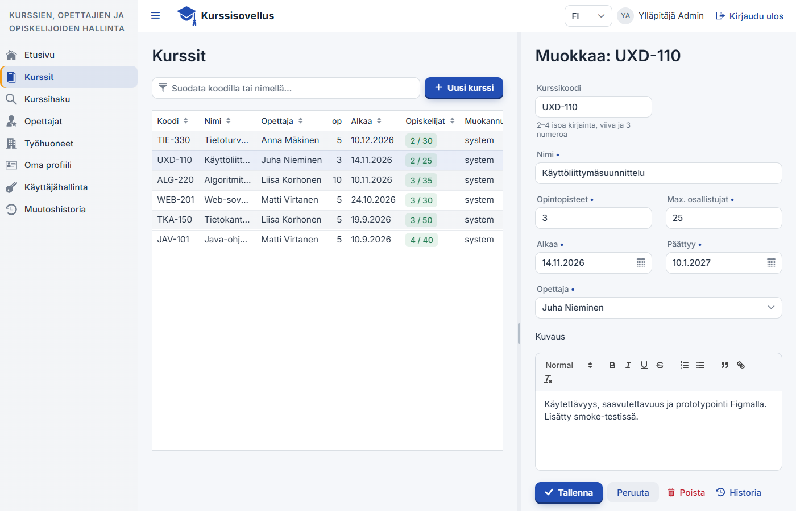
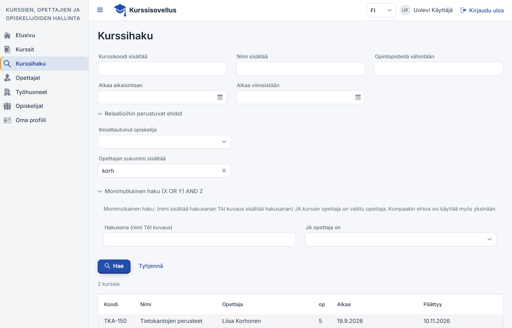
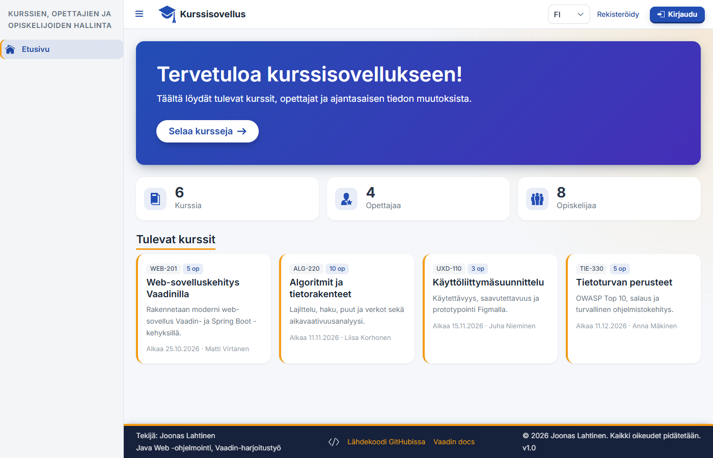
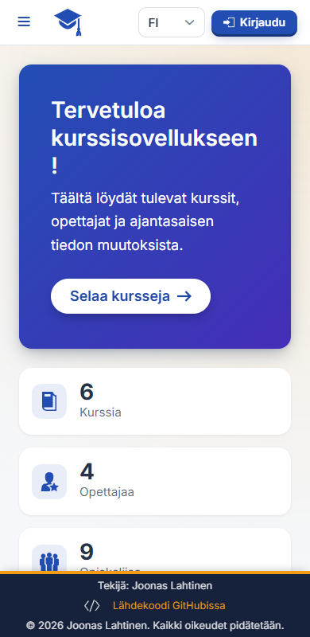
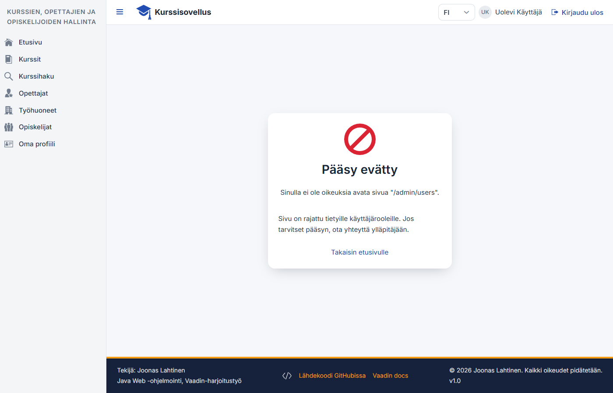
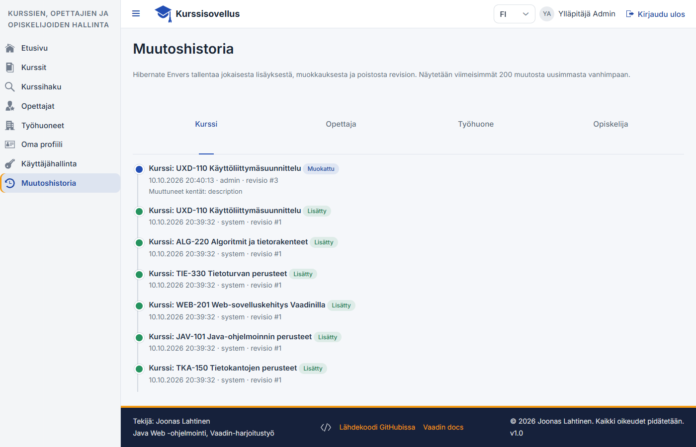
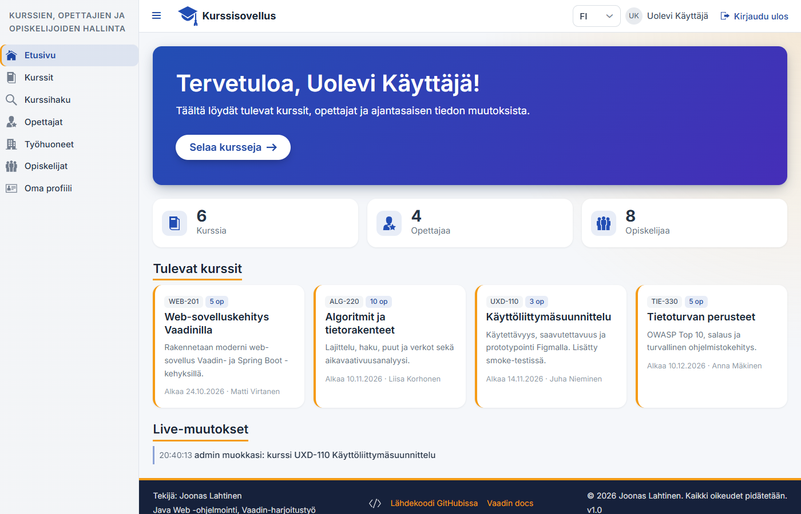

# Työraportti – Vaadin Web -harjoitustyö

**Tekijä:** Joonas Lahtinen
**Sovellus:** Kurssisovellus (kurssien, opettajien, työhuoneiden ja opiskelijoiden hallinta)
**Repositorio:** https://github.com/BlackTempo/kurssisovellus
**Tavoitearvosana:** 5

## Yhteenveto

| Osio | Täytetyt kohdat |
|---|---|
| Data, entiteetit ja CRUD | 5 / 5 |
| Suodattaminen (Criteria API) | 5 / 5 |
| Tyylit ja ulkoasu | 5 / 5 |
| Ulkoasu ja rakenne (SPA) | 5 / 5 |
| Autentikointi ja tietoturva | 4 / 5 (+ kohdan 16 roolipohjaiset sivut) |
| Muut toiminnallisuudet | 13 / 13 |
| **Yhteensä** | **37 / 38** |

Toteuttamatta jäi vain **kohta 20, OAuth-kirjautuminen (Gmail/GitHub)**. Se on vaatimuksista ainoa, joka edellyttää sovelluksen rekisteröintiä ulkoiseen palveluun ja salaisuuksien (client secret) hallintaa sekä paikallisesti että Dockerissa. Siksi se rajattiin pois vaikeimpana.

Kaikki tiedostopolut ovat suhteessa hakemistoon `src/main/java/fi/lahtinen/kurssit/`, ellei toisin mainita. Rivinumerot viittaavat palautushetken versioon. Kuvakaappaukset ovat hakemistossa [`docs/kuvat/`](docs/kuvat).

**Testaus.** Toteutusta on testattu kahdella tavalla:
- Integraatiotestit (`./mvnw test`, 22 testiä) kattavat Criteria-haun, rekisteröinnin ja ylläpitäjän sähköposti-ilmoituksen, salasanan palautuksen ja sen uudelleenlähetyksen rajoituksen, käyttäjän poiston, istuntojen katkaisun oikeuksien muuttuessa, CSV-tuonnin ja -viennin (myös kaavainjektion eston), auditoinnin, Envers-historian ja XSS-sanitoinnin.
- Selainpohjainen savutesti (Playwright) on ajettu Docker-ympäristöä vastaan tuotantotilassa. Siinä kirjaudutaan kaikilla rooleilla ja testataan Push kahden selaimen välillä, tiedostojen lataukset sekä salasanan palautus Mailpitiin tulleen linkin kautta.

## Arvioijan pikaohje

1. Käynnistä sovellus komennolla `docker compose up --build` ja avaa http://localhost:8080. Sähköpostit näkyvät osoitteessa http://localhost:8025.
2. **Kirjautumattomana:** etusivu näkyy (16). Kielen voi vaihtaa FI/EN (23). Rekisteröidy (17), ja ylläpitäjän ilmoitus ilmestyy Mailpitiin (26). Kokeile "Unohditko salasanan?" → linkki Mailpitistä → uusi salasana (27).
3. **`user` / `user123`:** Kurssit (CRUD, Quill, liitteet, historia), Kurssihaku (Criteria), Opettajat, Työhuoneet, Opiskelijat (CSV) ja Oma profiili (kuva). Avaa `/admin/users`, jolloin näkyy oma pääsy evätty -sivu (18).
4. **`admin` / `admin123`:** Käyttäjähallinta ja Muutoshistoria (32). Avaa `/students`, jolloin näkyy pääsy evätty -sivu (sivu on vain super- ja user-rooleille).
5. **Push (22):** pidä etusivu auki kirjautuneena yhdessä selaimessa ja tallenna kurssi toisessa. "Live-muutokset" päivittyy heti. Lista näkyy vain kirjautuneille, koska viesteissä on käyttäjätunnuksia ja opiskelijoiden nimiä.
6. **Oikeuksien muutos:** kirjaudu yhteen selaimeen `user`-tunnuksella ja lukitse tunnus toisessa selaimessa adminina (Käyttäjähallinta). `user` kirjataan ulos heti.

---

## 1. Data, entiteetit ja CRUD

Jokaisella entiteetillä on listaussivu (Grid), lomake uuden luomiseen, lomake muokkaukseen, poisto (vahvistusdialogilla) ja Repository. CRUD toimii käyttöliittymästä tietokantaan asti: Näkymä → Service (`@Transactional`) → Spring Data -repository → H2/PostgreSQL.

| Kohta | Toteutus | Missä |
|---|---|---|
| **1. Ensimmäinen entiteetti** | `Teacher` (opettaja) | `domain/Teacher.java`, `repository/TeacherRepository.java`, `service/TeacherService.java`, näkymä `ui/views/TeacherView.java` (reitti `/teachers`): grid + dialogilomake (uusi/muokkaa) + poisto `confirmDelete` (r. 169) |
| **2. 1:1-relaatio** | `Office` (työhuone) 1:1 `Teacher`. Office omistaa vierasavaimen `teacher_id`, jolla on `unique = true` (`Office.java` r. 51). Käänteinen puoli on `Teacher.office` (`mappedBy`, r. 59). | Relaatio näkyy opettajagridin sarakkeessa **"Työhuone"** (`TeacherView.java` r. 65–71) ja työhuonegridin sarakkeessa **"Opettaja"** (`OfficeView.java`). CRUD: `ui/views/OfficeView.java` (`/offices`), `OfficeService`, `OfficeRepository`. |
| **3. 1:N-relaatio** | `Teacher` 1:N `Course` (`Course.teacher` `@ManyToOne`, r. 69; `Teacher.courses` `@OneToMany`, r. 62) | Relaatio näkyy kurssigridin sarakkeessa **"Opettaja"** (`CourseView.java` r. 153). CRUD: `ui/views/CourseView.java` (`/courses`, master–detail), `CourseService`, `CourseRepository`. |
| **4. M:N-relaatio** | `Student` M:N `Course`, liitostaulu `course_student`. Omistava puoli on `Student.courses` (`Student.java` r. 62), käänteinen `Course.students` (r. 72). | Relaatio näkyy opiskelijagridin sarakkeessa **"Kurssit"** badgeina (`StudentView.java` r. 96) ja kurssigridin sarakkeessa **"Opiskelijat"** (täyttöaste, nimet tooltipissä SUPER- ja USER-rooleille, `CourseView.java` r. 159). Lomakkeessa ilmoittautumiset muokataan `MultiSelectComboBox`illa. CRUD: `ui/views/StudentView.java` (`/students`). |
| **5. Validoitavia kenttiä ≥ 5 / entiteetti** | Bean Validation -annotaatiot entiteeteissä, lomakkeissa `BeanValidationBinder`, joka näyttää virheet kentän vieressä. | **Teacher:** @NotBlank ×3, @Size ×3, @Email, @Pattern (puhelin), @NotNull, @PastOrPresent **Office:** @NotBlank ×2, @Pattern ×2 (huone `A123`, alanumero), @Size, @Min/@Max (kerros), @Positive, @NotNull ×3 **Course:** @NotBlank ×2, @Pattern (koodi `ABC-123`), @Size ×2, @Min/@Max (op), @NotNull ×5, @Positive, @Max, @AssertTrue (loppupäivä ≥ alkupäivä, `Course.java` r. 82) **Student:** @Pattern (`S123456`), @NotBlank ×4, @Size ×2, @Email, @Past, @PastOrPresent, @NotNull ×2 (Myös `CourseAttachment` ja `AppUser` sisältävät ≥ 5 validointia.) |

Virheelliset kentät näytetään punaisina ja virheviesti kentän alla. `ui/components/FormFields.java` antaa sähköposti- ja päivämääräkentille suomenkieliset virheviestit; muuten Vaadinin kenttien oma validointi hylkäisi arvon tyhjällä viestillä ennen entiteetin sääntöjä. Lisäksi käytössä ovat optimistinen lukitus (`@Version` kentässä `AbstractAuditableEntity`) sekä yksilöllisyystarkistukset palvelukerroksessa (sähköposti, kurssikoodi, opiskelijanumero).

---

## 2. Suodattaminen (Criteria API)

Toteutus on `repository/CourseRepositoryImpl.java`. Näkymä on `ui/views/CourseSearchView.java` (reitti `/search`, valikossa "Kurssihaku").

Kysely rakennetaan dynaamisesti metodissa `buildPredicates` (r. 85–137). Jokainen predikaatti lisätään `List<Predicate>`-listaan **vain, jos käyttäjä on täyttänyt vastaavan kentän** (`if (hasText(...))` / `if (... != null)`), ja lopuksi ne yhdistetään AND:llä.

| Vaatimus | Toteutus | Rivi |
|---|---|---|
| Predikaatit vain annetuista ehdoista | `if`-ehdot jokaisen predikaatin ympärillä | r. 85–137 |
| Osittainen tekstihaku (LIKE) | `likeIgnoreCase()`: `lower(kenttä) LIKE %arvo%`, käyttäjän `%`- ja `_`-merkit escapetaan | r. 143–149 |
| Päivämäärähaku | `cb.between(startDate, from, to)`; myös avoin väli (`>=` / `<=`) | r. 100–108 |
| OR-ehto | `cb.or(nameMatches, descriptionMatches)` | r. 130 |
| JOIN | `course.join("teacher")` ja `course.join("students")` | r. 45, 114 |

| Kohta | Toteutus |
|---|---|
| **1. Useat syötekentät (≥ 3)** | Kurssikoodi (LIKE), nimi (LIKE) ja opintopisteiden minimi (`>=`) – `CourseRepositoryImpl` r. 89–98 |
| **2. Päivämääräväli** | "Alkaa aikaisintaan" – "Alkaa viimeistään" – r. 100–108 |
| **3. Relaatioentiteetin perusteella JOINilla** | Hae kurssit, joille valittu **opiskelija** on ilmoittautunut (kenttä näkyy SUPER- ja USER-rooleille, koska ADMIN ei pääse opiskelijatietoihin): `join("students")` + `equal(id)` – r. 110–116 |
| **4. Relaatioentiteetin ominaisuuden perusteella** | Hae kurssit **opettajan sukunimen** osalla: `join("teacher")` + `lower(lastName) LIKE` – r. 118–121 |
| **5. Monimutkainen haku (X OR Y) AND Z** | (nimi sisältää hakusanan **OR** kuvaus sisältää hakusanan) **AND** opettaja = valittu opettaja. OR kootaan omaksi predikaatikseen, jotta sulkeistus on oikein – r. 123–133 |

Haku on sivutettu: ensin haetaan sivun id:t ehtojen mukaan, sitten kurssit opettajineen (r. 36–64). Erillinen count-kysely laskee gridin kokonaismäärän (r. 67–78), ja gridin lazy-dataprovider hakee vain näkyvän sivun. Testit: `src/test/java/.../repository/CourseSearchTest.java` (9 testiä, yksi jokaiselle kohdalle ja lisäksi escapointi ja sivutus).

---

## 3. Tyylit ja ulkoasu

Teeman tiedostot ovat hakemistossa `src/main/frontend/themes/kurssiteema/`, ja teema otetaan käyttöön `@Theme("kurssiteema")`-annotaatiolla (`config/AppShell.java` r. 17).

| Kohta | Toteutus |
|---|---|
| **6. Globaalit tyylit** | `styles.css`: • **perusfontti:** Inter (Google Fonts) varafontteineen, `--lumo-font-family` (r. 21) • **oletusfontin koko:** `--lumo-font-size-m: 0.95rem` (r. 22) • **oma väripaletti:** syvä sininen pääväri ja meripihkan sävyinen korostusväri, `--lumo-primary-color*`, success/error-värit ja `--app-accent` (r. 25–44) • **komponenttien kaarevuus:** `--lumo-border-radius-s/m/l` (r. 47–49) • **nappien syvyys:** primary-napeilla "fyysinen" alareuna ja varjo, joka painuu klikatessa (r. 57–67) • **tekstikenttien ulkoasu:** valkoinen tausta, ohut reuna ja fokusrengas sekä punainen virhetila `::part(input-field)` (r. 71–112) |
| **7a. addClassName** | Esim. `card.addClassName("course-card")` (`DashboardView.java` r. 209), `addClassName("dashboard-view")` (r. 105), `addClassName("app-footer")` |
| **7b. getStyle().set()** | Kurssikortin vasen reuna `getStyle().set("border-left", ...)` (`DashboardView.java` r. 211) ja hero-osion liukuväri (r. 152) |
| **7c. addThemeVariants** | `ButtonVariant.LUMO_PRIMARY/ERROR/TERTIARY`, `GridVariant.LUMO_ROW_STRIPES/COMPACT` (`CourseView.java` r. 165), `NotificationVariant` (`ui/components/Notifications.java`), `TabsVariant.LUMO_EQUAL_WIDTH_TABS` (`HistoryView`) |
| **8. Näkymäkohtainen CSS** | `views/dashboard-view.css`. Kaikki säännöt on rajattu `.dashboard-view`-luokkaan, jonka vain `DashboardView` asettaa itselleen. Tyylit vaikuttavat useaan Vaadin-komponenttiin samassa näkymässä: `h2` (otsikon alaviiva), `vaadin-button` (pyöreät napit), `vaadin-icon` (tilastoikonit) ja `vaadin-horizontal-layout` (rivittyvät korttirivit). |
| **9. Lumo Utility -luokat** | `DashboardView.createHero()` (r. 131–156) käyttää 8:aa luokkaa: **Background**.PRIMARY, **TextColor**.PRIMARY_CONTRAST, **Padding**.XLARGE, **BoxShadow**.MEDIUM, **BorderRadius**.LARGE, **Display**.BLOCK, **FontSize**.XXXLARGE/LARGE, **Margin**.Bottom.LARGE. Lisäksi samoja luokkia käytetään korteissa (FontSize, TextColor, Margin). |
| **10. Hover, focus ja transition** | `styles.css`: • `.course-card` (r. 117–137): `transition: transform .2s, box-shadow .2s`, **`:hover` zoomaa 3 %** (`scale(1.03)`), **`:focus-visible`** näyttää fokusrenkaan. Kortti on fokusoitava (`tabindex=0`). • `.fade-in-button` (r. 139–163): **fade-in-animaatio** `@keyframes fadeInUp`, hover-kirkastus ja focus-outline. • `prefers-reduced-motion` poistaa animaatiot saavutettavuuden vuoksi. |

---

## 4. Ulkoasu ja rakenne (SPA)

| Kohta | Toteutus |
|---|---|
| **11. SPA + MainLayout extends AppLayout** | `ui/MainLayout.java` (r. 71). Kaikki näkymät ovat muotoa `@Route(value = "...", layout = MainLayout.class)`, ja navigointi vaihtaa vain sisältöalueen ilman sivun uudelleenlatausta. Footer lisätään ylikirjoittamalla `showRouterLayoutContent` (r. 241), koska AppLayoutissa ei ole valmista footer-paikkaa. Pääsy evätty -virhesivu käyttää samaa layoutia `@ParentLayout(MainLayout.class)`-annotaatiolla. |
| **12. ≥ 3 erityyppistä layoutia** | (a) **DashboardView** (`/`): hero + korttiruudukko (CSS grid) + live-lista (b) **CourseView** (`/courses`): master–detail **SplitLayout** (grid vasemmalla, lomake oikealla) (c) **HistoryView** (`/admin/history`): **Tabs + pystysuuntainen aikajana** (d) TeacherView/StudentView: grid + **Dialog**-lomake (e) ProfileView ja kirjautumissivut: keskitetty kortti |
| **13. Header** | `MainLayout.createHeader()` (r. 127–161) ja `createUserSection()` (r. 163–): **DrawerToggle**, **logo** (ACADEMY_CAP-ikoni) + **sovelluksen nimi**, kielivalitsin, **käyttäjän tunniste** (Avatar ja nimi, profiilikuva jos asetettu) sekä **logout-painike** (`AuthenticationContext.logout()`). Kirjautumattomalle näytetään Kirjaudu- ja Rekisteröidy-napit. |
| **14. Navigointipalkki** | `MainLayout.createDrawer()` (r. 217–235): `SideNav`, jossa **jokaisella näkymällä on oma ikoni** (HOME, BOOK, SEARCH, USER_STAR, OFFICE, GROUP, USER_CARD, KEY, TIME_BACKWARD). SideNav **korostaa aktiivisen sivun** automaattisesti (`current`-attribuutti), ja korostusta on vahvistettu korostusvärisellä reunaviivalla (`layout.css` r. 52). Valikossa näytetään vain linkit, joihin käyttäjällä on oikeus (`AccessAnnotationChecker`). |
| **15. Footer** | `ui/components/AppFooter.java` + `layout.css` (r. 92–156): **tekijän nimi**, **© 2026**, **linkit** (GitHub-repositorio ja Vaadin docs) ja versio. Footer on **kiinnitetty näkymän alaosaan** `position: sticky; bottom: 0` -määrityksellä: se pysyy ikkunan alareunassa sisältöä vieritettäessä ja asettuu sivun lopussa sisällön alle, joten se ei peitä viimeisiä rivejä pysyvästi. Lyhyellä sivulla sisältöalue venyy (`flex: 1`), joten footer on silloinkin alareunassa. Footer **erottuu visuaalisesti** tumman taustan, korostusvärisen yläreunan ja varjon ansiosta. Se on **responsiivinen**: `@media (max-width: 700px)` (r. 140) pinoaa osiot keskitetysti ja piilottaa toissijaiset tiedot, jotta aina näkyvä footer ei vie liikaa tilaa mobiilissa. |

---

## 5. Autentikointi ja tietoturva

| Kohta | Toteutus |
|---|---|
| **16. Spring Security + oma käyttäjäentiteetti** | `config/SecurityConfig.java` (`extends VaadinWebSecurity`, `setLoginView`). Oma entiteetti on `domain/AppUser.java` (taulu `app_user`), ja roolit **ADMIN, SUPER ja USER** ovat enumissa `domain/Role.java`. **Salasanaa ei tallenneta**: kentässä `passwordHash` on vain **BCrypt-tiiviste** (`BCryptPasswordEncoder`, `SecurityConfig.java` r. 44). Tunnistus tapahtuu `security/AppUserDetailsService.java`:n kautta. Käyttäjät **admin/admin123** ja **user/user123** (sekä super/super123) luodaan `config/DataInitializer.java`:ssa. |
| **16. Roolipohjaiset sivut** | • **Kaikki** näkevät päänäkymän: `DashboardView` `@AnonymousAllowed` • **Kirjautuneet** näkevät: `CourseView`, `CourseSearchView`, `TeacherView`, `OfficeView`, `ProfileView` (`@PermitAll`) • **Super ja user** näkevät: `StudentView` `@RolesAllowed({"SUPER","USER"})` (`StudentView.java` r. 69) • **Vain admin** näkee: `UserAdminView` ja `HistoryView` `@RolesAllowed("ADMIN")` • **Oikeuksien muutos tulee voimaan heti:** kun ylläpitäjä muuttaa rooleja, lukitsee tai poistaa tunnuksen, `UserService` julkaisee `UserAccessChangedEvent`in. `service/AccessRevocationBroadcaster.java` kirjaa käyttäjän avoimet ikkunat ulos Pushilla (`MainLayout.onAttach`), ja `MainLayout.beforeEnter` tarkistaa jokaisella navigoinnilla, vastaako istunto vielä tietokantaa (`AuthenticatedUser.isAccessRevoked`). Ilman tätä Spring Securityn kirjautumishetkellä tallentamat roolit jäisivät voimaan. |
| **17. Rekisteröitymissivu** | `ui/views/auth/RegisterView.java` (`/register`). Kentät validoidaan, ja palvelu `UserService.register` tarkistaa tunnuksen ja sähköpostin yksilöllisyyden. Uusi käyttäjä saa aina USER-roolin; rooli asetetaan palvelimella, joten sitä ei voi manipuloida selaimesta. |
| **18. Oma virheviesti puuttuville oikeuksille** | `ui/views/AccessDeniedView.java` (`implements HasErrorParameter<AccessDeniedException>`, HTTP 403). Suojatuissa näkymissä on `@AccessDeniedErrorRouter(rerouteToError = AccessDeniedException.class)`, jottei Vaadin tuotantotilassa näytä oletusarvoista 404-sivua. Kokeilu: kirjaudu `user`-tunnuksella ja avaa `/admin/users`, tai `admin`-tunnuksella `/students`. |
| **19. Oma kuva käyttäjälle** | `ui/views/ProfileView.java` (`/profile`): `Upload` hyväksyy PNG/JPEG-kuvan (max 2 Mt). Tallennus tehdään metodissa `UserService.updateProfileImage`, joka tarkistaa tyypin ja koon. Kuva näkyy profiilissa ja headerin Avatarissa (`MainLayout.java` r. 206, `DownloadHandler`). |
| ~~20. OAuth (Gmail/GitHub)~~ | **Ei toteutettu**, ks. perustelu yhteenvedossa. |

---

## 6. Muut toiminnallisuudet

| Kohta | Toteutus |
|---|---|
| **21. GitHub** | Repositorio: https://github.com/BlackTempo/kurssisovellus. Commit-historia dokumentoi työn etenemisen. README.md sisältää käynnistysohjeet ja demotunnukset. |
| **22. Vaadin Server Push** | `@Push` (`config/AppShell.java` r. 18). `service/Broadcaster.java` välittää `DataChangedEvent`-tapahtumat **commitin jälkeen** (`@TransactionalEventListener(AFTER_COMMIT)`) kaikille avoimille UI:lle. `DashboardView` (r. 240) päivittää kirjautuneille "Live-muutokset"-listan ja kaikille tilastot, ja `CourseView` (r. 440) päivittää gridin ja näyttää ilmoituksen. UI:ta muokataan `ui.access()`-kutsun sisällä, ja rekisteröinti poistetaan `onDetach`-metodissa. *Kokeilu: avaa etusivu kirjautuneena yhdessä selaimessa ja muokkaa kurssia toisessa.* |
| **23. Lokalisointi (fi/en)** | `src/main/resources/vaadin-i18n/translations{,_fi,_en}.properties` (Vaadin `DefaultI18NProvider`). Kielivalitsin on headerissa (`MainLayout.java` r. 142–149) ja tallentaa kielen `VaadinSession`iin. Kokonaan lokalisoituja ovat **MainLayout (navigaatio, header), footer, etusivu, kirjautuminen, rekisteröityminen, salasanan palautus ja pääsy evätty -sivu** (`LocaleChangeObserver`). Myös etusivun live-viestit kootaan käännöksistä (`activity.*`, `entity.*`). Selaimen kieli valitaan automaattisesti. |
| **24. Docker-image + Dockerfile** | `Dockerfile`: monivaiheinen build (JDK + `-Pproduction` → JRE), ajo ei-root-käyttäjänä ja upload-volume. Vaadin ajetaan tuotantotilassa valmiiksi käännetyllä frontend-bundlella. |
| **25. docker-compose** | `docker-compose.yml`: **PostgreSQL 16** (healthcheck + volume), **sovellus** (käynnistyy, kun kanta on terve) ja **Mailpit** (SMTP + web-UI portissa 8025). Käynnistys: `docker compose up --build`. |
| **26. Sähköposti ylläpidolle uudesta käyttäjästä** | `UserService.register` julkaisee `UserRegisteredEvent`in, jonka `MailService.onUserRegistered` (r. 61) käsittelee `@Async` + `@TransactionalEventListener(AFTER_COMMIT)`: viesti lähetetään kaikille ADMIN-käyttäjille vasta, kun tallennus on onnistunut, eikä SMTP-virhe kaada rekisteröintiä. Viestit näkyvät Mailpitissä. |
| **27. Salasanan vaihto sähköpostin avulla** | `service/PasswordResetService.java`. "Unohditko salasanan?" -linkki (`ForgotPasswordView`) tai profiilisivun nappi luo 256-bittisen satunnaistokenin, josta tietokantaan (`PasswordResetToken`) tallennetaan vain **SHA-256-tiiviste**. Token on **voimassa 30 minuuttia** ja **kertakäyttöinen**. Linkki `/reset-password?token=…` avaa `ResetPasswordView`n. Vastaus on aina sama, jottei osoitteiden olemassaoloa voi selvittää. Viesti lähetetään vasta commitin jälkeen (`PasswordResetRequestedEvent` → `MailService.onPasswordResetRequested`), samalle käyttäjälle enintään kahden minuutin välein, ja salasanan vaihto mitätöi käyttäjän kaikki avoimet linkit. |
| **28. Tiedoston lataus ja tallennus** | Kurssiliitteet: `CourseView` (Upload r. 354, lataus `Anchor` + `DownloadHandler` + `AttachmentType.DOWNLOAD` r. 395) ja `service/FileStorageService.java`. Tiedostot tallennetaan levylle UUID-nimellä (path traversal -suoja), metatiedot `CourseAttachment`-entiteettiin. Tyyppi- ja kokorajat (10 Mt) tarkistetaan, ja rollbackin yhteydessä levylle jäänyt tiedosto siivotaan. |
| **29. CSV-tuonti ja -vienti** | `service/CsvService.java` (Apache Commons CSV). **Vienti** `exportStudents` (r. 82): UTF-8 + BOM ja puolipiste-erotin, jotta tiedosto aukeaa suoraan suomenkielisessä Excelissä. **Tuonti** `importStudents` (r. 113): jokainen rivi validoidaan entiteetin annotaatioilla, olemassa olevat opiskelijat päivitetään ja virheelliset rivit raportoidaan rivinumeroineen. Myös M:N-ilmoittautumiset siirtyvät kurssikoodeina. Vienti estää CSV-injektion: kaavamerkillä (`=`, `+`, `-`, `@`) alkavan arvon eteen lisätään heittomerkki, jonka tuonti poistaa. Napit "Vie CSV" ja "Tuo CSV" ovat opiskelijanäkymässä. |
| **30. Spring Auditing** | `config/AuditConfig.java` (`@EnableJpaAuditing`, `AuditorAware` = kirjautunut käyttäjä tai "system"). `domain/AbstractAuditableEntity.java` sisältää kentät `@CreatedBy`, `@CreatedDate`, `@LastModifiedBy` ja `@LastModifiedDate`, ja kaikki domain-entiteetit perivät sen. Kentät näkyvät kurssigridin sarakkeessa "Muokannut" sekä käyttäjähallinnan sarakkeissa "Luotu" ja "Luonut". |
| **31. Historiatiedot jokaisesta muutoksesta** | **Hibernate Envers**: `@Audited` kaikissa domain-entiteeteissä (myös M:N-liitostaulu ja AppUser ilman salasanaa ja kuvaa). `domain/CustomRevisionEntity.java` + `UserRevisionListener.java` tallentavat jokaiseen revisioon muutoksen tekijän. `application.properties`: `global_with_modified_flag` (muuttuneet kentät) ja `store_data_at_delete` (poistetun rivin arvot). |
| **32. Historia aikajanalla** | `ui/views/admin/HistoryView.java` (`/admin/history`): välilehti jokaiselle entiteettityypille ja **aikajana** (`ui/components/HistoryTimeline.java` + `views/history-view.css`), jossa näkyvät aika, tekijä, Lisätty/Muokattu/Poistettu, revisio ja **muuttuneet kentät**. Yksittäisen kurssin historia avautuu kurssilomakkeen **Historia**-napista. Data tulee `service/HistoryService.java`:sta (`forRevisionsOfEntityWithChanges`, r. 84). |
| **33. Ulkoinen JS-komponentti** | **Quill.js 2.0.3**: `ui/components/QuillEditor.java` (`@NpmPackage("quill")`, `@JsModule`, `extends AbstractSinglePropertyField`, toimii Binderin kanssa) + `src/main/frontend/components/quill-editor.ts` (Lit-kääre light DOMissa, koska Quill ei toimi Shadow DOMissa). Komponenttia käytetään kurssin kuvauskentässä. Tallennettu HTML sanitoidaan Jsoupilla (`service/HtmlSanitizer.java`) XSS:n estämiseksi. |

---

## Koodin kommentointi

Koodi on kommentoitu kertomaan **miksi** asiat tehdään, ei sitä, mitä koodi tekee. Jokaisen luokan Javadoc kertoo luokan roolin ja täytettävän vaatimuksen numeron. Esimerkkejä:
- `Broadcaster`: miksi viesti lähetetään vasta commitin jälkeen ja miksi käytetään omaa säiepoolia
- `CourseRepositoryImpl`: miksi OR sulkeistetaan ja miksi sivutus tehdään kahdessa vaiheessa
- `AbstractAuditableEntity`: miksi `equals`/`hashCode` perustuu id:hen ja miksi `hashCode` on vakio
- `AppUser`: miksi profiilikuvassa ei käytetä `@Lob`-annotaatiota PostgreSQL:n kanssa
- `quill-editor.ts`: miksi komponentti on light DOMissa

## Testit

| Testiluokka | Testaa |
|---|---|
| `KurssisovellusApplicationTests` | Koko Spring-konteksti käynnistyy |
| `repository/CourseSearchTest` (9) | Criteria-haun kohdat 1–5, LIKE-escapointi ja sivutus |
| `service/ServiceIntegrationTest` (12) | Rekisteröinti ja BCrypt, ylläpitäjän sähköposti, salasanan palautus ja kertakäyttöisyys, uudelleenlähetyksen rajoitus, palautusta pyytäneen käyttäjän poisto, oman tunnuksen poiston esto, istuntojen katkaisu oikeuksien muuttuessa, CSV-roundtrip virheellisillä riveillä, CSV-kaavainjektion esto, auditointi ja Envers-historia muuttuneine kenttineen, XSS-sanitointi, kurssikoodin yksilöllisyys |
